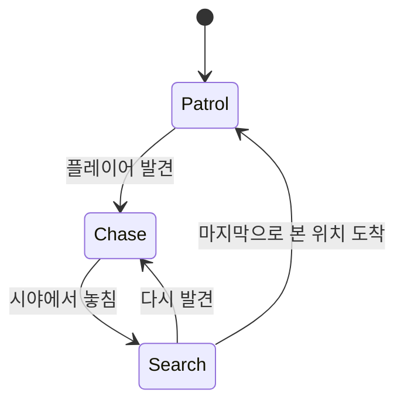

# Unity Enemy AI

NavMesh 경로 탐색과 FSM(유한 상태 머신)으로 구현한 **순찰 · 추적 · 수색** 적 AI

## 개요
| 항목 | 내용 |
|---|---|
| 엔진 | Unity 6 (6000.3.22f1), URP |
| 언어 | C# |
| 패키지 | AI Navigation 2.0.14, Input System 1.20.0 |
| 개발 인원 | 1명 |
| 개발 기간 | 2026.10 ~ 진행 중 |

기본 NavMesh 기능 학습, 상황에 따라 판단하는 적 AI를 직접 설계해 보는 것이 목표

## 주요 기능

### 1. 상태 머신 (FSM)



| 상태 | 행동 | 전환 조건 |
|---|---|---|
| **Patrol** | 웨이포인트를 순서대로 순환 | 플레이어 발견 → Chase |
| **Chase** | 플레이어 추적, 마지막으로 본 위치 기록 | 시야에서 놓침 → Search |
| **Search** | 마지막으로 본 위치까지 이동 | 다시 발견 → Chase / 도착 → Patrol |

<!-- TODO: 상태 전환 GIF -->

### 2. 감지 (거리 + 시야 가림)
- 감지 거리 안에 있어도 **벽에 가려지면 감지하지 못함**
- 적에서 플레이어 방향으로 `Physics.Raycast`를 쏴서, 처음 맞은 대상이 플레이어인지 판정
- 감지 범위는 `OnDrawGizmosSelected`로 Scene 뷰에 시각화

<!-- TODO: 벽 뒤에 숨으면 추적을 멈추는 GIF -->

### 3. 이동 (NavMesh 경로 탐색 + Rigidbody 물리 이동)
- `NavMeshAgent`는 **경로 계산만**, 실제 이동은 **Rigidbody**가 담당

### 4. 카메라
- `LateUpdate` + `Vector3.SmoothDamp`로 플레이어를 부드럽게 추적하는 쿼터뷰 카메라

## 설계 결정

### NavMeshAgent에 이동을 맡기지 않은 이유
- 적과 플레이어를 사람이 아닌 **사물**로 설정
- NavMeshAgent는 물리 엔진을 거치지 않고 Transform을 직접 옮기기 때문에 충돌, 밀림 같은 물리 반응이 생기지 않음
- 그래서 **경로 계산은 NavMeshAgent, 실제 이동은 Rigidbody**로 역할을 나눠 물리 반응이 가능하도록 구현

**구현 방법**
1. `updatePosition = false`, `updateRotation = false`로 Agent가 Transform을 직접 움직이지 못하게 함
2. `FixedUpdate`에서 Agent가 계산한 `desiredVelocity`를 `Rigidbody.linearVelocity`에 적용
3. 매 물리 프레임 `nextPosition = rb.position`으로 Agent의 내부 위치를 실제 위치와 동기화
   - 동기화하지 않으면 Agent 내부 위치만 혼자 앞서 나가 경로 계산이 어긋남

### 도착 판정
- `!pathPending && remainingDistance <= stoppingDistance`
- `SetDestination` 직후에는 경로 계산이 끝나지 않아 `remainingDistance`를 믿을 수 없으므로 `pathPending`을 먼저 확인
- Agent는 `stoppingDistance`에서 멈추므로, 직접 정한 숫자가 아니라 이 설정값과 비교

## 트러블슈팅

### NavMeshAgent + Rigidbody 오브젝트 순간이동이 되지 않음
- **문제**: 시작 위치를 옮기려고 `transform.position`을 바꿨지만 적이 제대로 이동하지 않음
- **원인**
  - Agent의 내부 위치는 그대로라, Agent가 순간이동을 인식하지 못함 (`nextPosition`은 NavMesh를 따라 끌어오는 방식이라 순간이동이 안 됨)
  - 경로(`SetDestination`)를 순간이동보다 먼저 계산함
- **해결**: `rb.position`으로 물리 위치 이동 → `NavMeshAgent.Warp`로 Agent 이동 → 그다음 `SetDestination`
- **배운 점**: Rigidbody와 함께 쓰면서 `updatePosition`을 끄면 위치가 물리 위치와 Agent 내부 위치 두 곳으로 나뉘므로, 순간이동할 때는 둘 다 옮겨야 함. 경로 계산은 이동을 마친 뒤에 해야 함

### 수색 후 순찰로 돌아갈 때 웨이포인트를 건너뜀
- **문제**: 웨이포인트로 가던 중 플레이어를 발견하고, 추적과 수색을 마친 뒤 가던 웨이포인트가 아닌 다른 웨이포인트로 이동
- **원인**: 
  수색이 끝날 때 부르던 NextPatrolPoint()가 "인덱스 +1"과 "그 지점으로 이동"을 한꺼번에 함
- **디버깅**: 
  Debug.Log로 인덱스, 상태, Time.frameCount를 찍어서 확인
- **해결**:
  - GoCurrentPatrolPoint(): 인덱스를 유지한 채 이동. Start와 수색 종료 때 사용
  - GoNextPatrolPoint(): +1 한 뒤 GoCurrent를 호출. Patrol에서 도착했을 때만 사용

### 같은 이동 코드인데 플레이어만 구름 (조사 중)
<!-- 조사 후 작성 -->

## 프로젝트 구조

```
Assets/Scripts/
├── PlayerMove.cs   # Input System 입력 → Rigidbody 이동
├── CameraMove.cs   # SmoothDamp 카메라 추적
└── EnemyMove.cs    # 적 AI (FSM, 감지, NavMesh + Rigidbody 이동)
```

## 앞으로 할 일

- [X] 웨이포인트 건너뛰기 버그 수정
- [ ] 시야각(FOV) 감지
- [ ] 공격 상태
- [ ] 여러 마리 적 (LayerMask로 감지 대상 필터링)
- [ ] State 패턴으로 리팩터링

## AI 활용

개발 과정에서 Claude(Anthropic)를 멘토이자 코드 리뷰어로 활용했습니다. 개념 설명, 구현 방향 제시, 코드 리뷰를 받았고, 코드는 직접 작성했습니다. 개발 과정은 커밋 히스토리에서 확인할 수 있습니다.
